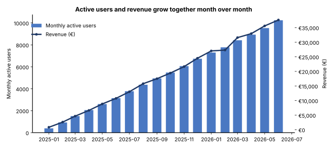
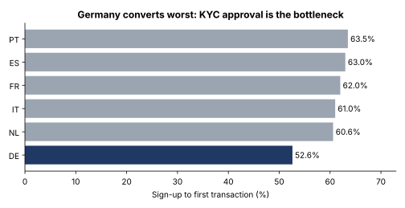
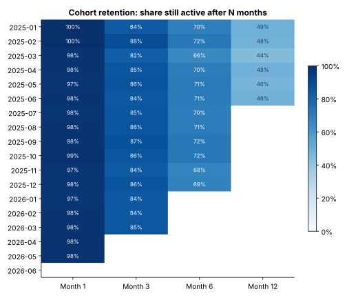
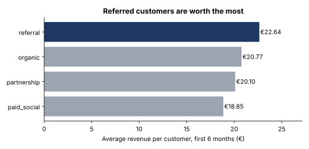
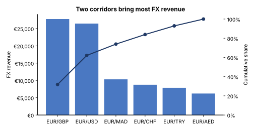

# EuroPay — SQL Analytics for a European Neobank

An end-to-end SQL analysis of **EuroPay**, a fictional digital bank operating in six European markets. The project answers ten questions a growth, product or risk team would actually ask, using about **930,000 transactions** from **25,000 customers** over 18 months (January 2025 – June 2026).

All analysis is written in SQL and runs on [DuckDB](https://duckdb.org/) (PostgreSQL-style syntax). Python is used only to generate the dataset, run the queries and draw the charts.

> The data is synthetic, generated by `data/generate_data.py` with a fixed seed, so every number below can be reproduced exactly. Patterns (a KYC bottleneck in one market, injected fraud bursts, channel quality differences) were built in deliberately so the queries have something real to find.



---

## Key findings

| # | Question | Finding |
|---|----------|---------|
| 1 | How fast are we growing? | Monthly active users grew from **393 to 10,246** and monthly revenue from **€842 to €37,626** over 18 months. Revenue per active user rose from €2.14 to €3.67. |
| 2 | Where do new customers drop out? | Germany converts only **52.6%** of sign-ups into active users vs **60.6–63.5%** elsewhere. Every step is in line except **KYC approval: 77.7% in DE vs ~89–93%** in other markets. |
| 3 | Do customers stay? | Around **85%** of each cohort is still active at month 3, **~70%** at month 6 and **~47%** at month 12, stable across cohorts. |
| 4 | Who are our best customers? | **Champions** (19% of customers) generate **43%** of spend. 734 "cannot lose them" customers (high past value, inactive ~7 months) are the clearest win-back target. |
| 5 | Which channel brings the best customers? | **Referral** customers bring the most revenue in their first 6 months (**€22.64** avg) and **paid social** the least (**€18.85**), 20% lower. |
| 6 | Where does FX revenue come from? | Two corridors, **EUR/GBP and EUR/USD, make 62%** of FX revenue at a steady ~0.68% take rate. |
| 7 | Who churns? | Paid social has the worst churn on every plan (**49% on Standard**), referral the best (**23%**). Premium customers churn least overall (26%). |
| 8 | Any fraud-like activity? | The velocity rule flags **47 accounts**. Checked against the injected ground truth: **100% precision, 89% recall** (see limitations). |
| 9 | Do referrals spread? | Referral chains go up to **6 levels** deep; the top referrers each started networks of 8–9 customers, mostly indirect. |
| 10 | Which market to prioritise? | **Portugal and Italy** score best on a five-metric scorecard; **Germany** ranks last, driven by the KYC issue above. |

### Recommendations

1. **Fix German KYC first.** Bringing DE approval up to the ~90% seen elsewhere would turn roughly 340 more German sign-ups into active customers with no extra marketing spend. It is the largest single lever in the data.
2. **Shift budget from paid social to referral.** Referred customers are worth more and churn about half as often. A higher referral bonus is likely cheaper than paid acquisition.
3. **Run a win-back campaign** on the "at risk" and "cannot lose them" RFM segments (2,488 customers, 23% of total spend).
4. **Protect the two main FX corridors** (pricing, partner rates). Revenue is concentrated, so a competitor undercutting EUR/GBP or EUR/USD would hurt.

---

## The queries

| File | Business question | SQL techniques |
|------|------------------|----------------|
| [`01_monthly_kpis.sql`](sql/01_monthly_kpis.sql) | Month-over-month growth | CTEs, `date_trunc`, `LAG`, `generate_series` month spine, subscription revenue from a slowly changing dimension |
| [`02_onboarding_funnel.sql`](sql/02_onboarding_funnel.sql) | Funnel drop-off by country | Conditional aggregation with `FILTER`, pivoting events to columns, `ROLLUP` for the total row, `MEDIAN` |
| [`03_cohort_retention.sql`](sql/03_cohort_retention.sql) | Cohort retention | Cohort assignment, `date_diff` month offsets, conditional `COUNT DISTINCT`, NULL for periods not yet observable |
| [`04_rfm_segmentation.sql`](sql/04_rfm_segmentation.sql) | Customer segmentation | `NTILE` quintiles, rule-based `CASE` segments, share of total with window aggregates |
| [`05_channel_ltv.sql`](sql/05_channel_ltv.sql) | 6-month value by channel | Revenue from three sources (interchange, FX fees, subscriptions), per-customer time windows, `GROUPING SETS` |
| [`06_fx_corridors.sql`](sql/06_fx_corridors.sql) | FX revenue concentration | Running totals with `SUM() OVER (ORDER BY …)`, `RANK`, Pareto share |
| [`07_churn_by_segment.sql`](sql/07_churn_by_segment.sql) | Churn by plan and channel | `LEAD` for gaps between transactions, churn flag, `ROLLUP` with `GROUPING()` labels |
| [`08_fraud_velocity.sql`](sql/08_fraud_velocity.sql) | Fraud-like bursts | `RANGE BETWEEN INTERVAL 10 MINUTE PRECEDING` time windows, per-customer baselines, `QUALIFY` |
| [`09_referral_network.sql`](sql/09_referral_network.sql) | Referral chains | `WITH RECURSIVE` to walk a tree of unknown depth |
| [`10_market_scorecard.sql`](sql/10_market_scorecard.sql) | Market prioritisation | Several metric CTEs joined, `RANK()` per metric, composite score |

Full outputs for every query are in [`results/`](results/) as Markdown tables (CSV copies are written when you run the pipeline).

---

## Charts

| | |
|---|---|
|  |  |
|  |  |

---

## Data model

```
customers ───────────┬──< onboarding_events   (signed_up → kyc_submitted → kyc_approved → card_activated → first_transaction)
  customer_id (PK)   ├──< plan_history        (plan, valid_from, valid_to)  ── plan_fees (plan, monthly_fee_eur)
  country            ├──< transactions        (txn_ts, category, amount_eur, is_fx, fx_pair, fx_fee_eur, interchange_eur, status)
  signup_date        │
  acquisition_channel│
  referred_by ───────┘  (self-reference: who referred this customer)
```

- **6 markets:** France, Italy, Spain, Germany, Portugal, Netherlands
- **4 acquisition channels:** organic, paid social, referral, partnership
- **3 plans:** Standard (free), Plus (€3.99/month), Premium (€9.99/month)
- **Revenue model:** card interchange + FX fees + subscriptions
- `completed_txns` is a view that keeps only completed transactions; most queries use it.

---

## How to run

```bash
git clone https://github.com/tamerelbe/europay-sql-analytics.git
cd europay-sql-analytics
pip install -r requirements.txt

python data/generate_data.py   # creates data/raw/*.csv (~70 MB, seeded)
python run_analysis.py         # builds europay.duckdb, runs every query, writes results/ and charts/
```

The whole pipeline runs in a few seconds. To explore interactively, open the database with the DuckDB CLI (`duckdb europay.duckdb`) and run any file in `sql/`.

---

## Limitations and next steps

- **Synthetic data.** Real neobank data would be messier (duplicates, late-arriving events, refunds), and the month-1 retention here (~98%) is higher than a real product would see.
- **Fraud baseline.** The 6 missed fraud accounts all had few transactions, so the burst itself pushed up their "typical" spend. A better baseline would use only transactions *before* each window.
- **Churn definition.** "No transaction for 60 days" is a simple rule; a production version would be checked against account closures.
- **Next:** build these as dbt models with tests, and put the KPIs into a Power BI or Tableau dashboard.

---

*Built by [Tamer Elbenghazi](https://github.com/tamerelbe), Data & Business Analytics graduate, IE University.*
